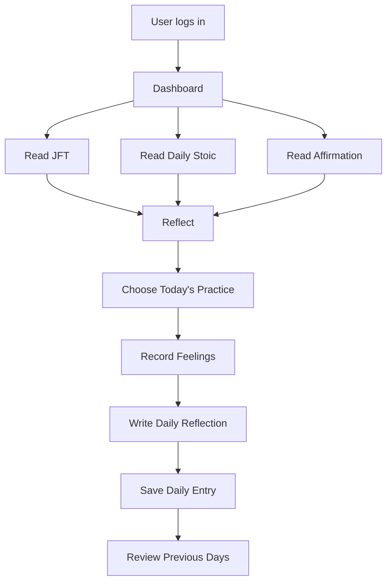
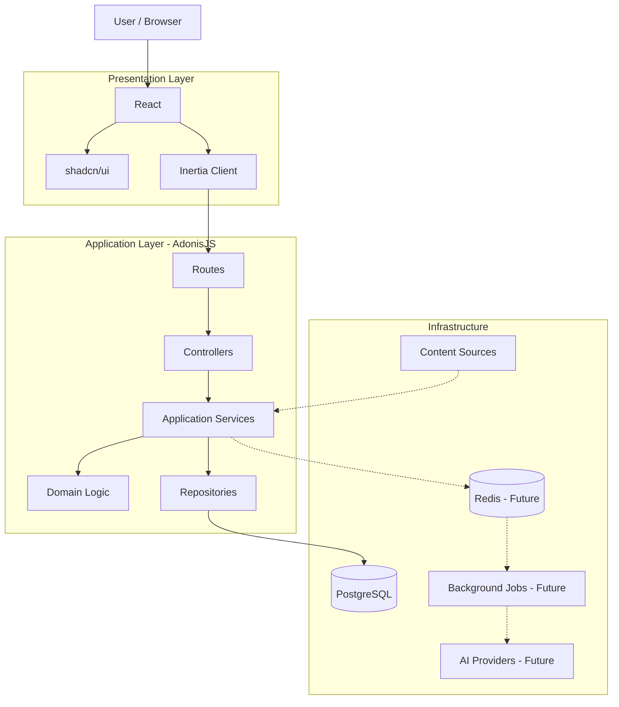
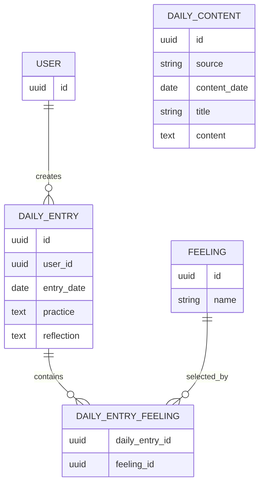

# Ascend — Architecture Overview

## 1. Overview

Ascend is a personal growth and reflection application designed initially for personal use.

The first version focuses on creating a meaningful daily practice:

> **Read → Reflect → Practice → Record → Review**

When the user logs in, Ascend presents a daily dashboard containing:

- Just For Today (JFT) content
- Daily Stoic content
- Positive affirmations
- Daily practice/intention
- Feelings
- Daily reflection

The application will begin as a **modular monolith** using AdonisJS, Inertia.js, React, PostgreSQL, and shadcn/ui.

The architecture should remain simple enough to develop quickly while establishing engineering practices that allow the system to grow into a larger personal development platform.

---

## 2. Product Vision

Ascend aims to help a person consistently practice intentional living and personal growth.

Rather than being only a habit tracker or journal, Ascend combines:

- Daily philosophical/spiritual reflection
- Personal reflection
- Intentional practice
- Emotional awareness
- Positive reinforcement
- Historical reflection
- Eventually, goals, habits, fitness, nutrition, and AI-assisted guidance

The initial product is intentionally personal.

We will optimize for **clarity, usefulness, and learning**, rather than premature scalability.

---

## 3. Initial User Experience

The primary user journey is:



The dashboard should feel like a **daily ritual**, not an administration interface.

---

# 4. High-Level Architecture



---

# 5. Technology Stack

## Frontend

### React

React is responsible for the interactive user interface.

Responsibilities include:

- Rendering dashboard components
- Forms
- User interactions
- Client-side UI state
- Loading and error states
- Accessibility
- Interactive journal components

React should not contain core business rules that belong on the server.

---

### Inertia.js

Inertia provides the bridge between AdonisJS and React.

Conceptually:

```text
Browser
   │
   │ HTTP
   ▼
AdonisJS
   │
   │ Inertia response
   ▼
React Page
```

This allows Ascend to retain a server-driven application architecture while using React for the user interface.

We avoid creating a separate REST/GraphQL backend solely for the web frontend unless a future requirement justifies one.

---

### shadcn/ui

shadcn/ui provides reusable UI primitives.

It should be treated as a UI building-block system rather than the application's architecture.

Domain-specific components will be built around these primitives.

For example:

```text
shadcn Button
      ↓
SaveReflectionButton
```

rather than putting application-specific behavior into generic UI components.

---

# 6. Backend Architecture

AdonisJS is the primary application backend.

The backend follows a layered/modular approach:

```text
HTTP Request
     │
     ▼
   Route
     │
     ▼
 Controller
     │
     ▼
 Application Service
     │
     ▼
 Domain Logic
     │
     ▼
 Repository
     │
     ▼
 PostgreSQL
```

Each layer has a distinct responsibility.

## Controllers

Controllers translate HTTP requests into application operations.

They should be thin.

A controller should generally:

1. Receive the request
2. Validate/obtain input
3. Call the appropriate application service
4. Return an Inertia response or HTTP response

Business logic should not accumulate inside controllers.

---

## Services

Services coordinate application operations.

For example:

```text
DailyReflectionService
```

might coordinate:

- Finding today's entry
- Validating the operation
- Creating or updating the reflection
- Persisting the result

Services represent meaningful application operations rather than arbitrary utility functions.

---

## Domain Logic

Domain logic represents rules that are important to Ascend itself.

Examples:

- A user can have at most one daily reflection for a given date.
- A daily entry belongs to exactly one user.
- Content has an associated publication date.
- A daily practice belongs to a particular day.
- Feelings recorded for a day belong to that day's personal entry.

Domain rules should remain independent of HTTP concerns.

---

## Repositories

Repositories provide a boundary around persistence operations where that abstraction provides value.

For example:

```text
DailyEntryRepository
DailyContentRepository
```

The repository layer should not exist simply because "Clean Architecture says repositories are required."

We introduce abstractions when they improve:

- Separation of concerns
- Testability
- Complex persistence logic
- Domain boundaries
- Future infrastructure changes

For simple CRUD operations, AdonisJS/Lucid can be used directly where appropriate.

---

# 7. Core Domain Model

The first version contains two major categories:

```text
                    Ascend
                       │
          ┌────────────┴────────────┐
          │                         │
       Content                  Personal Data
          │                         │
   ┌──────┼──────┐          ┌───────┴────────┐
   │      │      │          │                │
  JFT   Stoic  Affirm.   Daily Entry      User
```

This separation is important.

## Content

Content is material presented to the user.

Examples:

- JFT
- Daily Stoic
- Positive affirmations

Content may be imported, manually entered, updated, or eventually synchronized from external sources.

---

## Personal Data

Personal data represents what the user does with the content.

Examples:

- Daily practice
- Feelings
- Reflection
- Notes

The user's reflection should never be treated as content.

This distinction gives the system a clean boundary:

```text
CONTENT
"What am I reading today?"

PERSONAL DATA
"What did this mean to me?"
"What am I practicing?"
"How am I feeling?"
```

---

# 8. Initial Domain Entities

The initial model is intentionally small.



The exact schema will be decided during database/domain modeling.

The architecture does **not** assume that this diagram is the final database schema.

---

# 9. Daily Content Model

JFT, Daily Stoic, and affirmations should initially use a generalized content model.

Conceptually:

```text
DailyContent

id
source
content_date
title
content
metadata
created_at
updated_at
```

Where:

```text
source
──────
jft
daily_stoic
affirmation
```

This is preferable to immediately creating separate systems for each source.

For example:

```text
daily_contents

2026-09-11 | jft          | ...
2026-09-11 | daily_stoic  | ...
2026-09-11 | affirmation  | ...
```

If additional daily content sources are introduced later, the architecture can accommodate them without redesigning the entire dashboard.

---

# 10. Daily Entry

A `DailyEntry` represents the user's personal interaction with a particular day.

Conceptually:

```text
DailyEntry
│
├── user
├── date
├── practice
├── feelings
├── reflection
└── timestamps
```

A user's date should uniquely identify their daily entry.

Conceptually:

```text
(user_id, entry_date) → unique
```

This prevents accidental creation of multiple daily journals for the same user and date.

---

# 11. Content vs Daily Entry

This is one of the most important architectural boundaries in Ascend.

Consider:

```text
September 11

JFT
"Today's reading..."

Daily Stoic
"Today's reading..."

Affirmation
"I choose..."

--------------------------------

My Practice
"Be patient when I feel frustrated."

My Feelings
"Anxious, hopeful"

My Reflection
"Today I noticed..."
```

The first section is **content**.

The second section is **personal state**.

They should have different ownership, lifecycle, and persistence rules.

---

# 12. Future Domains

The initial version should not implement every planned feature.

However, the architecture should leave clear boundaries for future domains.

Potential future modules:

```text
src/
├── domains/
│   ├── content/
│   ├── journal/
│   ├── goals/
│   ├── habits/
│   ├── workouts/
│   ├── nutrition/
│   ├── progress/
│   ├── notifications/
│   └── ai/
```

The exact AdonisJS directory structure will follow the framework's conventions and our evolving domain boundaries.

We should not create empty modules simply because we expect them to exist someday.

---

# 13. AI Architecture — Future

AI is intentionally not part of the first implementation.

When introduced, AI should be treated as a subsystem rather than a chatbot bolted onto the dashboard.

Potential capabilities include:

```text
User
 │
 ▼
AI Interaction
 │
 ├── Current conversation
 ├── Daily entry
 ├── Relevant historical reflections
 ├── Goals
 ├── Habits
 └── Retrieved knowledge
          │
          ▼
     Context Builder
          │
          ▼
       LLM Provider
          │
          ▼
    Structured Response
```

Future AI architecture may include:

- Provider abstraction
- Structured outputs
- Context engineering
- Conversation history
- Tool calling
- Embeddings
- Semantic search
- RAG
- Personal context retrieval
- AI safety boundaries
- Token/cost tracking
- Evaluation
- Rate limiting

AI should only be introduced after the underlying personal-data model is mature enough to provide meaningful context.

---

# 14. Redis and Background Jobs

Redis is **not required for the initial dashboard**.

The initial architecture should rely primarily on PostgreSQL.

Redis may later be introduced for concrete requirements such as:

- Background jobs
- Caching
- Rate limiting
- Temporary state
- AI workloads
- Notifications

Similarly, background workers should be introduced when there are operations that genuinely benefit from asynchronous processing.

Examples:

```text
Generate embeddings
Send notification
Process imported content
Generate AI analysis
Send email
```

We should not introduce Redis or queues simply because they are considered "production technologies."

---

# 15. Data Ownership

PostgreSQL is the source of truth for application data.

```text
                 PostgreSQL
                     │
        ┌────────────┼────────────┐
        │            │            │
      Users       Content      Daily Entries
                                  │
                           Personal Reflections
```

The application should avoid having multiple competing sources of truth.

Caches, queues, and derived data are secondary systems.

---

# 16. Security

Security is part of the architecture from the beginning.

Important principles include:

### Authentication

Users must be authenticated before accessing personal data.

### Authorization

A user must only be able to access their own personal entries.

Conceptually:

```text
Request
   │
   ▼
Authenticated User
   │
   ▼
Does this resource belong to this user?
   │
 ┌─┴─┐
Yes  No
 │    │
 ▼    ▼
Allow Deny
```

### Server-side secrets

External API keys, AI provider credentials, and other secrets must never be exposed to React/browser code.

### Validation

Input should be validated at the application boundary.

### Database constraints

Important invariants should also be enforced at the database level where appropriate.

---

# 17. Observability

Even a personal application should be observable enough to understand failures.

The architecture will eventually include:

```text
Application
    │
    ├── Structured Logs
    ├── Error Tracking
    ├── Metrics
    └── Performance Monitoring
```

The goal is not enterprise-level monitoring on day one.

The goal is learning how production systems detect and diagnose problems.

---

# 18. Testing Strategy

Testing will evolve alongside the application.

### Unit Tests

For isolated domain/business logic.

### Integration Tests

For:

- Database operations
- Services
- Authentication
- Important application workflows

### End-to-End Tests

For critical user journeys.

Example:

```text
Login
  ↓
Open Dashboard
  ↓
Read today's content
  ↓
Write practice
  ↓
Select feelings
  ↓
Write reflection
  ↓
Save
  ↓
Reopen entry
  ↓
Verify data
```

The goal is not maximum test coverage.

The goal is confidence in important behavior.

---

# 19. Deployment Architecture

The initial deployment can remain simple:

```text
                    Internet
                       │
                       ▼
                Ascend Application
                   AdonisJS
                       │
             ┌─────────┴─────────┐
             │                   │
             ▼                   ▼
        PostgreSQL            Assets
```

As requirements grow:

```text
                    Internet
                       │
                       ▼
                Reverse Proxy
                       │
                       ▼
                 Ascend App
                       │
          ┌────────────┼────────────┐
          │            │            │
          ▼            ▼            ▼
     PostgreSQL      Redis        Worker
```

Containerization will be used where it improves development/deployment consistency.

---

# 20. Scalability Strategy

Ascend will start as a modular monolith.

```text
             ASCEND
                │
        ┌───────┴───────┐
        │               │
     Modules         Infrastructure
        │               │
   ┌────┼────┐       PostgreSQL
   │    │    │
Journal Content Goals
```

If the application eventually becomes large enough, individual components can be extracted based on actual scaling or organizational requirements.

Possible future extraction:

```text
Ascend Monolith
      │
      ├── Core Application
      ├── AI Worker
      └── Notification Worker
```

We will **not** begin with microservices.

---

# 21. Architectural Principles

The following principles guide development.

### 1. Start simple

Complexity must be justified by a real requirement.

### 2. Domain before technology

We first understand the problem and domain, then choose technical solutions.

### 3. PostgreSQL is the source of truth

Other infrastructure exists to support the application, not compete with the database.

### 4. Thin controllers

HTTP handling belongs in controllers; business decisions belong elsewhere.

### 5. Keep personal data separate from content

External/daily content and the user's private reflections have different responsibilities.

### 6. Server owns business logic

React handles presentation and interaction; important business rules remain server-side.

### 7. Security by design

Authentication, authorization, validation, and secret management are architectural concerns.

### 8. Measure before optimizing

Caching, queues, indexing, and other optimizations should be driven by actual requirements or evidence.

### 9. Document important decisions

Architectural decis
